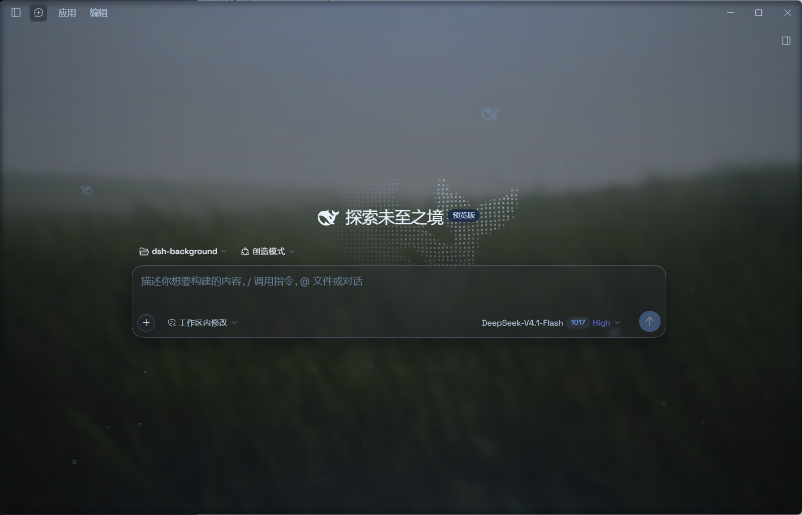
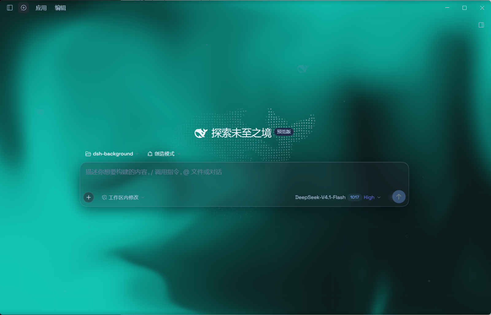

# DSH Aqua · 透明玻璃主题适配版

基于 Aqua 主题，为 **DeepSeek Harness 0.2.1-rc.2** 适配桌面布局，支持透明背景、悬浮侧栏和自定义壁纸。当前补丁版本：`1.3.1-patch.7`。

## 效果预览

**壁纸背景**



**流体背景**



## 主要改动

- 修复桌面主栏遮挡流体背景和壁纸的问题。
- Windows 云母模式下，收起后显示 **72px 悬浮图标栏**，点击鲸鱼可展开；收起按钮位于品牌行右侧，“应用／编辑”菜单位置保持固定。
- 左右侧栏统一使用 **12px 留白、20px 圆角**和玻璃材质，右侧栏放大后也保留悬浮效果。
- 适配新版设置入口，保留深浅色、模糊度、磨砂度、壁纸及环境装饰等原作功能。

## 安装

桌面版使用 `desktop` profile：

```powershell
dsh plugin --profile desktop add github:dyx003/dsh-client-ui-aqua-patched
```

Web 版将 `desktop` 替换为实际使用的 profile，例如 `web`。安装或更新后，完整退出 Harness（包括托盘驻留）并重新打开；Web 部署重启宿主后刷新页面。

## 使用

- **总开关：** 设置 → 插件 → 玻璃主题。
- **效果调节：** 通用设置 → 外观下方的主题设置。
- **悬浮效果：** 选择云母模式；兼容模式保留宿主布局。

本次适配目标为 DSH `0.2.1-rc.2`。最新放大悬浮样式已通过静态检查，其他平台、窄屏和多屏缩放尚未完成全面回归。详细改动见 [更新记录](CHANGELOG.md)。

## 来源与致谢

- **原作者：** [WYH66666666](https://github.com/WYH66666666)
- **原作仓库：** [DSH-Transparent-UI-Plugin](https://github.com/WYH66666666/DSH-Transparent-UI-Plugin)
- **此前修补版本：** [Aliww2468/dsh-client-ui-aqua-patched](https://github.com/Aliww2468/dsh-client-ui-aqua-patched)

本仓库基于上述项目继续适配，原始设计与功能归原作者所有。按 **AGPL-3.0-only** 分发，详见 [LICENSE](LICENSE)。
