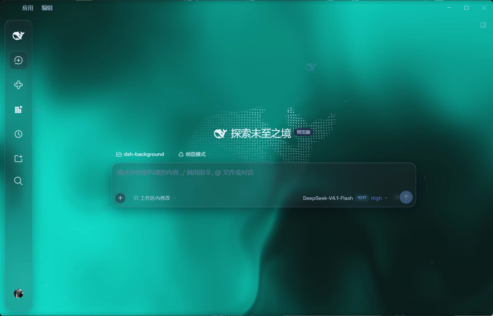
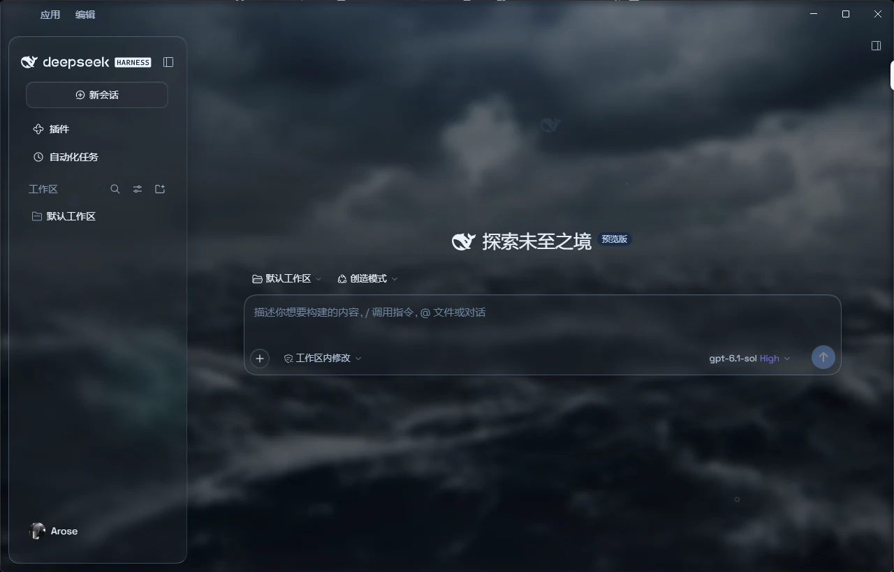
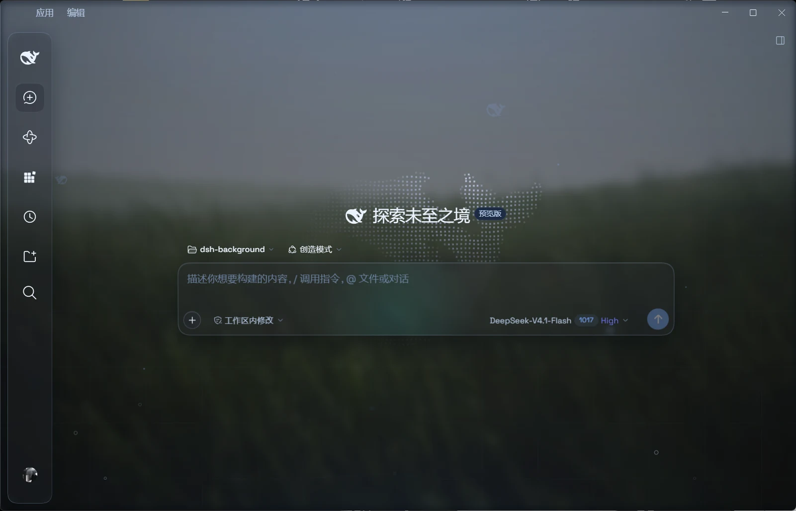

# DSH Aqua · 透明玻璃主题适配版

为 **DeepSeek Harness 0.2.1-rc.2** 适配的 Aqua 玻璃主题：让流体背景或自定义壁纸透过聊天区、输入框和悬浮侧栏，同时保留宿主操作。

**当前版本：`1.3.1-patch.9`** · [更新记录](CHANGELOG.md) · [适配与验证说明](DESKTOP-ADAPTATION.md)

## 效果预览

### 流体背景 · 收起侧栏

青绿色流体背景搭配窄幅玻璃图标栏，收起后仍可使用常用入口。



### 自定义壁纸 · 展开侧栏

壁纸透过玻璃侧栏与输入框，品牌行右侧保留收起按钮。



### 自定义壁纸 · 收起侧栏

点击顶部鲸鱼可重新展开侧栏，“应用／编辑”菜单在切换前后保持原位。



以上为 Windows 桌面截图，使用 WebP 压缩并保留原始分辨率，三张合计约 119 KiB。

## 主要改动

- 修复桌面主栏遮挡流体背景和壁纸的问题。
- Windows 云母模式下，收起后显示 **72px 悬浮图标栏**，点击鲸鱼可展开；收起按钮位于品牌行右侧，“应用／编辑”菜单位置保持固定。
- 收起时，顶部鲸鱼、新建会话与下方按钮组统一使用 **150ms 滑入淡显动画**，支持系统“减少动态效果”设置。
- 左右侧栏统一使用 **12px 留白、20px 圆角**和玻璃材质，右侧栏放大后也保留悬浮效果。
- 适配新版设置入口，保留深浅色、模糊度、磨砂度、壁纸及环境装饰等原作功能。

## 安装

需要已安装 Harness，并能在终端使用 `dsh` 和 `git`。桌面版使用 `desktop` profile：

```powershell
dsh plugin --profile desktop add github:dyx003/dsh-client-ui-aqua-patched
```

Web 版使用对应的 profile，例如：

```powershell
dsh plugin --profile web add github:dyx003/dsh-client-ui-aqua-patched
```

安装或更新后，**完整退出 Harness（包括托盘驻留）并重新打开**。Web 部署则重启宿主，再刷新页面。

## 使用

- **总开关：** 设置 → 插件 → 玻璃主题。
- **效果调节：** 通用设置 → 外观下方的主题设置。
- **悬浮效果：** 选择云母模式；兼容模式保留宿主布局。
- **背景：** 可选择流体背景或自定义壁纸，调节模糊、磨砂等参数。
- **恢复原生界面：** 关闭插件总开关。

卸载桌面 profile 中的插件：

```powershell
dsh plugin --profile desktop remove dsh-client-ui-aqua
```

卸载后同样需要完整退出并重新打开；Web 版将 profile 改为实际使用的名称。

## 开发与验证

本仓库包含可直接加载的 `lib` 产物。修改 Aqua CSS 或 DOM 标记后，可使用 Node.js 22.13 及以上版本同步并检查：

```powershell
npm run sync:visual
npm run check:visual
node --check lib/client.js
```

该同步工具仅处理视觉 CSS 与 DOM 标记模块，不能替代完整 TypeScript 构建。详细方法见 [适配与验证说明](DESKTOP-ADAPTATION.md)。

当前适配目标为 DSH `0.2.1-rc.2`。已在隔离的同版本网页实例中模拟 Windows 布局，检查侧栏往返、动画规则及按钮命中；本文截图展示 Windows 桌面效果。其他平台、窄屏、多屏缩放及原生 Electron 交互尚未完成全面回归。

## 来源与致谢

- **原作者：** [WYH66666666](https://github.com/WYH66666666)
- **原作仓库：** [DSH-Transparent-UI-Plugin](https://github.com/WYH66666666/DSH-Transparent-UI-Plugin)
- **此前修补版本：** [Aliww2468/dsh-client-ui-aqua-patched](https://github.com/Aliww2468/dsh-client-ui-aqua-patched)

本仓库基于上述项目继续适配，原始设计与功能归原作者所有。按 **AGPL-3.0-only** 分发，详见 [LICENSE](LICENSE)。
